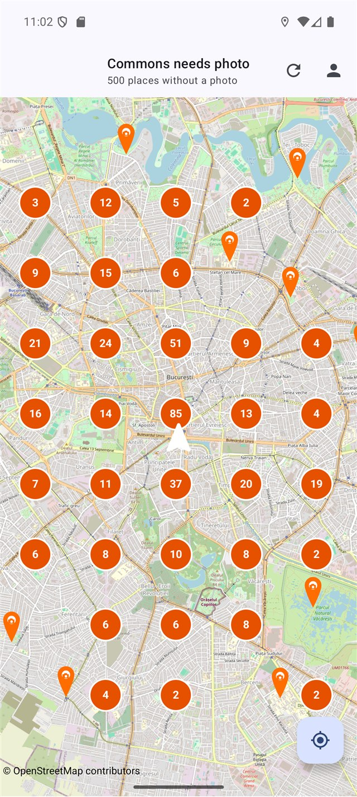

# Commons needs photo (MVP)

A small Android app that shows Wikidata places around you that have **no photo on Wikimedia Commons**, and lets you upload a photo for one of them.

It is a deliberately simplified MVP of the **Nearby** and **Upload** parts of the official
[Commons Android app](https://github.com/commons-app/apps-android-commons). Only those two
flows are implemented — there are no Explore/Bookmarks/Contributions tabs.




## What it does

* **Map of places without a photo.** The app runs the same kind of Wikidata SPARQL query as the
  original Commons app (`wikibase:around` + `FILTER NOT EXISTS { ?q wdt:P18 ?image }`) and shows
  the results on an OpenStreetMap map. Dense areas are clustered by screen cells; tapping a cluster
  zooms in, tapping a single pin opens the upload dialog.
* **Manual refresh.** Panning and zooming keep the last result set and do **not** issue a query.
  The **Search this area** button appears when the map centre moves more than 250 m from the last
  searched centre. The **My location** button only recentres the map — it does not reload places;
  tap **Search this area** (or the refresh icon) when you want fresh data. The next query radius is
  derived from the current viewport (centre to the north-east corner, clamped to 0.5–30 km).
* **Photo upload dialog.** Tap a pin to open a bottom sheet with the place name, description,
  distance, Wikidata link and a “No photo on Commons yet” badge. The sheet lets you:
  * take a photo with the camera or pick one from the gallery;
  * edit the Commons file name, description and category (prefilled from Wikidata `P373`);
  * choose a licence (CC BY-SA 4.0, CC BY 4.0 or CC0);
  * upload the file to Wikimedia Commons.
* **Real Commons upload.** The upload uses the MediaWiki API directly:
  `action=query&meta=tokens&type=csrf` → `action=upload` with a multipart file and a
  `{{Information}}` / `{{Location}}` / `{{self|cc-by-sa-4.0}}` wikitext page. The file name is
  checked against Commons and a random suffix is appended if it already exists, so files are not
  overwritten. After the upload the app adds the file to the Wikidata item as the **P18** (image)
  claim — that is what keeps the point out of the next search. The Wikidata edit is best effort: a
  failure there never undoes the Commons upload, and the success screen explains that the point may
  return.
* **Photo pipeline.** The selected image is decoded, oriented from EXIF, scaled to at most 4096 px,
  saved as JPEG (quality 92), and the camera EXIF is copied. If the photo has no GPS, the place
  coordinates are written into EXIF.
* **Localisation.** English and Russian UI.

## Requirements

* Android 9 (API 26) or newer.
* JDK 17 or newer for the build (tested with JDK 21).
* Android SDK 36 (`compileSdk = 36`).

## Build and run

```bash
./gradlew :app:assembleDebug
# Windows:
gradlew.bat :app:assembleDebug

adb install -r app/build/outputs/apk/debug/app-debug.apk
```

If Gradle reports `Value '...' given for org.gradle.java.home Gradle property is invalid`, point it
at a valid JDK explicitly:

```bash
./gradlew :app:assembleDebug "-Dorg.gradle.java.home=/path/to/jdk-21"
```

The project has the same tag-driven release setup as the sibling apps: pushing a tag such as
`v2026.11.22` runs `.github/workflows/main.yml`, runs the unit tests, builds an APK and attaches it
to the GitHub release.

For a **signed** release, add `KEYSTORE_BASE64`, `KEYSTORE_PASSWORD`, `KEY_ALIAS` and
`KEY_PASSWORD` repository secrets and place `app/my-release-key.jks` in the build. Without those
secrets the workflow still publishes a release, but with a **debug-signed** APK (it is marked as
such in the release notes), so a tag is never left without an installable artifact.

```bash
base64 -w0 my-release-key.jks > my-release-key.jks.base64
gh secret set KEYSTORE_BASE64 < my-release-key.jks.base64
gh secret set KEYSTORE_PASSWORD --body "***"
gh secret set KEY_ALIAS --body "***"
gh secret set KEY_PASSWORD --body "***"
```

On Windows PowerShell:

```powershell
[Convert]::ToBase64String([IO.File]::ReadAllBytes("my-release-key.jks")) |
  Set-Content -NoNewline my-release-key.jks.base64
gh secret set KEYSTORE_BASE64 < my-release-key.jks.base64
```

Create a release:

```bash
git tag v2026.11.22
git push origin v2026.11.22
```

## Logging in to upload

Commons uploads require an account. The normal path is your **regular Wikimedia account**:

1. Enter your username and password. This uses the same `action=clientlogin` flow as the original
   Commons app.
2. If two-factor authentication is enabled, the app asks for the 6-digit authenticator code (or
   the email code) on the next step and finishes the login.
3. If Commons asks for a CAPTCHA or another step the MVP does not support, the app suggests a bot
   password instead.

A **Wikimedia bot password** is optional and also supported:

1. Open <https://commons.wikimedia.org/wiki/Special:BotPasswords> in a browser and log in.
2. Create a bot password, e.g. `phone`, and grant **Upload new files** and **Create, edit, and
   move pages** (the second grant is used for the automatic Wikidata `P18` update).
3. Note the generated login name `YourUsername@phone` and the one-time password.
4. In the app tap the account icon (or “Log in” in the upload sheet), enter
   `YourUsername@phone` and the generated password.

The app does **not** store the password. For a normal login the password is kept in memory only
during the two-factor step, and the app keeps the Commons session cookies in an app-private
preference file (`commons_session`) which is excluded from Android backups. When the session
expires, log in again.

The original Commons app uses the same `action=clientlogin` flow and stores the account in Android's
`AccountManager`; this MVP deliberately keeps only the cookies. The bot-password path uses
`action=login` and is the fallback for unsupported verification methods.

## How the code is organised

```
app/src/main/java/com/example/commonsneedsphoto/
├── CommonsNeedsPhotoApp.kt        Application, osmdroid cache/user-agent, app container
├── MainActivity.kt                Compose host
├── data/
│   ├── model/                     NearbyPlace, LatLon, haversine distance
│   ├── network/
│   │   ├── WikidataNearbyRepository.kt  SPARQL query + kotlinx.serialization parser
│   │   ├── CommonsApi.kt               login, CSRF, unique file name, multipart upload
│   │   ├── WikidataApi.kt              P18 claim after upload (best effort)
│   │   ├── CommonsSession.kt           persistent OkHttp CookieJar
│   │   └── Network.kt                  shared OkHttp client and User-Agent
│   ├── photo/PhotoProcessor.kt    EXIF rotation, resize, JPEG, geotagging
│   ├── location/LocationProvider.kt    one-shot LocationManager fix
│   └── upload/                    wikitext builder, file-name rules, licence enum
└── ui/
    ├── MainViewModel.kt           screen state, search, login, upload orchestration
    ├── MapScreen.kt               osmdroid map, clustered canvas overlay, permission flow
    ├── UploadSheet.kt             photo picker, metadata form, licence, progress, success
    ├── LoginDialog.kt             bot-password login
    └── TakePictureWithPermission.kt  camera contract with FileProvider write grant
```

Dependencies are intentionally small: **Jetpack Compose (Material 3)**, **osmdroid** for the map,
**OkHttp** for HTTP, **kotlinx.serialization** for JSON and **Coil** for the photo preview. There is
no DI framework, database or navigation library — the MVP is a single screen plus two dialogs.

### Nearby query

`WikidataNearbyRepository.buildQuery()` produces:

```sparql
SELECT ?q ?qLabel ?desc ?location
       (SAMPLE(?category) AS ?commonsCategory)
       (GROUP_CONCAT(DISTINCT ?instanceOfLabel; separator=", ") AS ?instanceOfLabels)
WHERE {
  SERVICE wikibase:around {
    ?q wdt:P625 ?location .
    bd:serviceParam wikibase:center "Point(26.1025 44.4268)"^^geo:wktLiteral .
    bd:serviceParam wikibase:radius "5.00" .
  }
  FILTER NOT EXISTS { ?q wdt:P18 ?image }
  FILTER NOT EXISTS { ?q wdt:P576 ?dissolvedDate }
  FILTER NOT EXISTS { ?q wdt:P5816 wd:Q56556915 }
  OPTIONAL { ?q wdt:P373 ?category }
  OPTIONAL {
    ?q wdt:P31 ?instanceOf .
    ?instanceOf rdfs:label ?instanceOfLabel .
    FILTER(LANG(?instanceOfLabel) = "en")
  }
  SERVICE wikibase:label {
    bd:serviceParam wikibase:language "ru,en" .
    ?q rdfs:label ?qLabel .
    ?q schema:description ?desc .
  }
}
GROUP BY ?q ?qLabel ?desc ?location
LIMIT 500
```

The query is the same “items without P18” shape used by the NoPhotoWikidata/StuffAround apps. The
original Commons app instead loads all geolocated items in the viewport and colours the ones
without a photo red; this MVP filters them in SPARQL because that is all it shows.

Map tiles come from OpenStreetMap and are displayed with attribution. The app sets a descriptive
User-Agent for osmdroid and should not be used for bulk tile downloads.

## Known limitations (MVP scope)

* At most **500 places per search**; a city centre will reach that limit.
* The `P18` claim is added on a **best-effort** basis after the upload. If the Wikidata edit is
  rejected (no Wikidata session, missing “Create, edit, and move pages” right, or a network error),
  the file still stays on Commons and the success screen says that the point can return after a
  refresh. A Wikidata failure never rolls back the Commons upload.
* One file at a time, direct upload (no chunked stash/resume); photos are compressed to ≤ 4096 px.
* No duplicate-image SHA checks, title blacklist, depicts/captions, category search, multiple
  files, offline cache or background WorkManager upload.
* The query returns every kind of Wikidata item with coordinates (including businesses and
  streets), exactly like the raw query. There is no “only attractions” filter.
* The app is an unofficial MVP and is not affiliated with Wikimedia Commons.

## Data and attribution

* Place data: Wikidata (CC0), queried through `https://query.wikidata.org/sparql`.
* Map tiles: © OpenStreetMap contributors, ODbL.
* Uploaded photos: the licence chosen by the uploader (CC BY-SA 4.0 by default).
* Upload endpoint: `https://commons.wikimedia.org/w/api.php`.
* Wikidata API: `https://www.wikidata.org/w/api.php` (the `P18` claim after upload).

## Credits

The nearby/upload behaviour, the upload wikitext layout and the MediaWiki request parameters were
modelled on [commons-app/apps-android-commons](https://github.com/commons-app/apps-android-commons)
(especially `PageContentsCreator`, `UploadClient` and the Nearby SPARQL resources).
