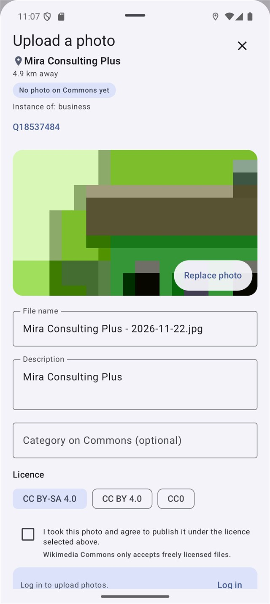

# Commons needs photo (MVP)

A small Android app that shows Wikidata places around you that have **no photo on Wikimedia Commons**, and lets you upload a photo for one of them.

It is a deliberately simplified MVP of the **Nearby** and **Upload** parts of the official
[Commons Android app](https://github.com/commons-app/apps-android-commons). Only those two
flows are implemented — there are no Explore/Bookmarks/Contributions tabs.




## What it does

* **Map of places without a photo.** The app runs the same kind of Wikidata SPARQL query as the
  original Commons app (`wikibase:around` + `FILTER NOT EXISTS { ?q wdt:P18 ?image }`) and shows
  the results on an OpenStreetMap map. Dense areas are clustered by screen cells; tapping a cluster
  zooms in, tapping a single pin opens the upload dialog. A cluster whose points sit too close to
  separate even at the maximum zoom (several items on one coordinate, for example) opens a sheet
  listing those places instead, so its pins are always reachable.
* **Manual refresh.** Panning and zooming keep the last result set and do **not** issue a query.
  The **Search this area** button appears when the map centre moves more than 250 m from the last
  searched centre. The **My location** button only recentres the map at the zoom level you have
  chosen — it does not reload places; tap **Search this area** (or the refresh icon) when you want
  fresh data. The next query radius is derived from the current viewport (centre to the
  north-east corner, clamped to 0.5–30 km).
* **Saved points between restarts.** The result of the last successful search is stored on the
  device with its centre and radius. Opening the app again shows the same points immediately and
  does not query Wikidata while the saved points are less than a day old; after a day the app
  drops them and searches again as usual. Only an explicit refresh or **Search this area**
  replaces them before that.
* **Photo editing before upload.** The pencil on the photo preview opens a small editor with
  three tools:
  * **Crop** — drag the corners, pick a 1:1, 4:3, 3:2 or 16:9 frame, or rotate the photo by
    90°;
  * **Geometry** — drag the four corners of the subject and the area is rectified with a
    perspective transform (the document workflow); **Auto geometry** finds straight lines,
    estimates where they meet (vanishing points) and applies a frame-preserving virtual-camera
    rotation, with a preview of the corrected canvas and the rectangle that will be saved;
  * **Colour** — one automatic correction for light, colour cast and contrast, with a strength
    slider. It is a histogram/percentile + grey-world white-balance + contrast matrix, not an
    AI filter.
  Editing is non-destructive while the sheet is open: the preview is computed at screen
  resolution, and the full-resolution JPEG (≤ 4096 px) is rendered only when the checkmark is
  tapped. The camera EXIF and GPS from the processed photo are copied to the edited file.
* **Photo upload dialog.** Tap a pin to open a bottom sheet with the place name, description,
  distance, Wikidata link and a “No photo on Commons yet” badge. The sheet lets you:
  * take a photo with the camera or pick one from the gallery;
  * edit the Commons file name, description and category (prefilled from Wikidata `P373`);
  * choose a licence (CC BY-SA 4.0, CC BY 4.0 or CC0);
  * upload the file to Wikimedia Commons.
* **Settings, excluded places and exclusion categories.** The gear in the top bar opens a
  settings page. Its first setting is the list of excluded places. The crossed-out eye in a
  place card hides that place from the map and from later search results, and the settings list
  shows every excluded place with a cross that puts it back. Exclusions live in an app-private
  preference file (`ignored_places`) and survive restarts. The second setting lists the
  **exclusion categories** — Wikidata “instance of” types such as hotel, quarter or siege whose
  places are skipped; the list starts with the same ten defaults as the StuffAround app and can
  be edited. The saved search snapshot still contains the excluded points, so restoring one or
  removing a category needs no new query.
* **Real Commons upload, in 512 KB chunks.** The upload uses the MediaWiki API directly:
  `action=query&meta=tokens&type=csrf` → `action=upload&stash=1&ignorewarnings=1` for every
  512 KB chunk → `action=upload` with the returned `filekey` to publish the finished stash and a
  `{{Information}}` / `{{Location}}` / `{{self|cc-by-sa-4.0}}` wikitext page. The `filekey` and
  the accepted byte offset are saved after every chunk, so a retry continues the stash instead
  of starting from zero. The file name is checked against Commons and a random suffix is
  appended if it already exists, so files are not overwritten. After the upload the app adds the
  file to the Wikidata item as the **P18** (image) claim — that is what keeps the point out of
  the next search. The Wikidata edit is best effort: a failure there never undoes the Commons
  upload, and the success screen explains that the point may return.
* **Background upload with WorkManager.** The upload sheet enqueues a `CoroutineWorker` with a
  “network connected” constraint and observes its `WorkInfo`, so the sheet shows chunk progress,
  the publishing step, success, failure and the P18 result. The work runs in a `dataSync`
  foreground service with a progress notification, survives screen rotation and app restarts,
  retries network/server errors with exponential backoff, and turns an expired Commons session
  into a clear “log in again” message instead of a generic failure.
* **Photo pipeline.** The selected image is decoded, oriented from EXIF, scaled to at most 4096 px,
  saved as JPEG (quality 92), and the camera EXIF is copied. If the photo has no GPS, the place
  coordinates are written into EXIF. Editing re-encodes the same processed file after the
  rotation / auto-upright / perspective / crop / colour steps and copies the EXIF to the new
  file.
* **Localisation.** English and Russian UI.

## Requirements

* Android 9 (API 26) or newer.
* JDK 17 or newer for the build (tested with JDK 21).
* Android SDK 36 (`compileSdk = 36`).

## Build and run

```bash
./gradlew :app:assembleDebug
# Windows:
gradlew.bat :app:assembleDebug

adb install -r app/build/outputs/apk/debug/app-debug.apk
```

The debug build has the package id `com.example.commonsneedsphoto.debug` and the launcher name
“… (debug)”, so it installs next to a release build instead of replacing it. The release build
keeps `com.example.commonsneedsphoto`, so the two can be logged in to different accounts. The CI
fallback described below always uses the **release** variant, so its APK name and package never
contain `debug`.

If Gradle reports `Value '...' given for org.gradle.java.home Gradle property is invalid`, point it
at a valid JDK explicitly:

```bash
./gradlew :app:assembleDebug "-Dorg.gradle.java.home=/path/to/jdk-21"
```

The project has the same tag-driven release setup as the sibling apps: pushing a tag such as
`v2026.11.22` runs `.github/workflows/main.yml`, runs the unit tests, builds an APK and attaches it
to the GitHub release.

For a **signed** release, add `KEYSTORE_BASE64`, `KEYSTORE_PASSWORD`, `KEY_ALIAS` and
`KEY_PASSWORD` repository secrets and place `app/my-release-key.jks` in the build. Without those
secrets the workflow still publishes a release: it builds the **release** variant (the normal
package id and app name) and signs it with the Android debug key, so the APK is still installable
and its name has no `-debug` suffix. The release notes mark it as debug-signed. A tag is never
left without an installable artifact.

```bash
base64 -w0 my-release-key.jks > my-release-key.jks.base64
gh secret set KEYSTORE_BASE64 < my-release-key.jks.base64
gh secret set KEYSTORE_PASSWORD --body "***"
gh secret set KEY_ALIAS --body "***"
gh secret set KEY_PASSWORD --body "***"
```

On Windows PowerShell:

```powershell
[Convert]::ToBase64String([IO.File]::ReadAllBytes("my-release-key.jks")) |
  Set-Content -NoNewline my-release-key.jks.base64
gh secret set KEYSTORE_BASE64 < my-release-key.jks.base64
```

Create a release:

```bash
git tag v2026.11.22
git push origin v2026.11.22
```

## Logging in to upload

Commons uploads require an account. The normal path is your **regular Wikimedia account**:

1. Enter your username and password. This uses the same `action=clientlogin` flow as the original
   Commons app.
2. If two-factor authentication is enabled, the app asks for the 6-digit authenticator code (or
   the email code) on the next step and finishes the login.
3. If Commons asks for a CAPTCHA or another step the MVP does not support, the app suggests a bot
   password instead.

A **Wikimedia bot password** is optional and also supported:

1. Open <https://commons.wikimedia.org/wiki/Special:BotPasswords> in a browser and log in.
2. Create a bot password, e.g. `phone`, and grant **Upload new files** and **Create, edit, and
   move pages** (the second grant is used for the automatic Wikidata `P18` update).
3. Note the generated login name `YourUsername@phone` and the one-time password.
4. In the app tap the account icon (or “Log in” in the upload sheet), enter
   `YourUsername@phone` and the generated password.

After the Commons login the app also signs in to Wikidata with the same bot password. Wikimedia
shares bot passwords across its wikis, and a bot-password session cannot create the
`centralauthtoken` used for normal logins, so this second sign-in is what gives the `P18` edit a
Wikidata session. The bot password needs the **Create, edit, and move pages** grant for it.

For a normal account the app does not log in to Wikidata with your password. Instead it asks
Commons for a short-lived, single-use **`centralauthtoken`** and repeats every authenticated
Wikidata request in that one-request session.

The app does **not** store the password. For a normal login the password is kept in memory only
during the two-factor step, and the app keeps the Commons session cookies in an app-private
preference file (`commons_session`) which is excluded from Android backups. When the session
expires, log in again.

The original Commons app uses the same `action=clientlogin` flow and stores the account in Android's
`AccountManager`; this MVP deliberately keeps only the cookies. The bot-password path uses
`action=login` and is the fallback for unsupported verification methods.

## How the code is organised

```
app/src/main/java/com/example/commonsneedsphoto/
├── CommonsNeedsPhotoApp.kt        Application, osmdroid cache/user-agent, app container
├── MainActivity.kt                Compose host
├── data/
│   ├── model/                     NearbyPlace, LatLon, haversine distance
│   ├── network/
│   │   ├── WikidataNearbyRepository.kt  SPARQL query, label fallback and parser
│   │   ├── CommonsApi.kt               login, CSRF, unique name, chunk stash + publish
│   │   ├── WikidataApi.kt              P18 claim, CentralAuth token, bot-password sign-in
│   │   ├── CommonsSession.kt           persistent OkHttp CookieJar
│   │   └── Network.kt                  shared OkHttp client and User-Agent
│   ├── photo/
│   │   ├── PhotoProcessor.kt    EXIF rotation, resize, JPEG, geotagging, stale-file cleanup
│   │   ├── PhotoEdits.kt        normalised crop/quad/auto-geometry data and geometry maths
│   │   ├── PhotoEditRenderer.kt rotation, upright warp, perspective warp, crop, JPEG + EXIF
│   │   ├── AutoGeometry.kt      line-based Upright, framing and minimal export crop
│   │   ├── LineSegmentDetector.kt  gradient-region line detector (LSD-lite)
│   │   └── AutoEnhance.kt       histogram/white-balance/contrast colour matrix
│   ├── location/LocationProvider.kt    one-shot LocationManager fix
│   ├── store/
│   │   ├── NearbyPlacesStore.kt  saved nearby points, one-day expiry
│   │   ├── IgnoredPlacesStore.kt places hidden from the map, restored in settings
│   │   └── ExclusionCategories.kt  skipped Wikidata types, defaults, shared preferences
│   └── upload/
│       ├── UploadChunks.kt        512 KB chunk plan, offsets, 6 h stash lifetime
│       ├── UploadResume.kt        filekey + offset, published-but-P18-pending marker
│       ├── ChunkedUploader.kt     stash/resume/publish orchestration
│       ├── UploadWorker.kt        WorkManager worker, foreground notification, P18
│       ├── UploadWork.kt          request, input/output keys, WorkInfo observation
│       ├── UploadNotifications.kt progress and result notifications
│       ├── UploadErrors.kt        session/permanent/retry classification
│       ├── WikitextBuilder.kt     {{Information}} page and file-name rules
│       └── UploadLicense.kt       licence enum and templates
└── ui/
    ├── MainViewModel.kt           screen state, search, login, upload, editor state
    ├── MapScreen.kt               osmdroid map, clustered canvas overlay, permission flow
    ├── SettingsScreen.kt          settings page, excluded places and exclusion categories
    ├── UploadSheet.kt             photo picker, edit button, metadata form, licence, progress
    ├── PhotoEditorState.kt        editor state kept across rotation
    ├── PhotoEditorDialog.kt       crop/geometry/colour editor with draggable overlays
    ├── LoginDialog.kt             bot-password login
    └── TakePictureWithPermission.kt  camera contract with FileProvider write grant
```

Dependencies are intentionally small: **Jetpack Compose (Material 3)**, **osmdroid** for the map,
**OkHttp** for HTTP, **kotlinx.serialization** for JSON, **Coil** for the photo preview and
**WorkManager** (`work-runtime-ktx`) for background uploads. There is no DI framework, database or
navigation library — the MVP is a single map screen with full-screen dialogs (the photo editor
and settings) and bottom sheets.

### Automatic geometry

The Geometry tab has two tools. Four draggable corners apply a document-style perspective crop
(the selected quadrilateral is mapped to a rectangle). **Auto geometry** works on the whole
frame instead:

1. The rotated preview is downscaled to 1024 px and converted to grey.
2. `LineSegmentDetector` grows regions of similar edge direction and fits a line to each region,
   keeping long, thin segments (a small LSD-like detector).
3. `UprightEstimator` separates near-vertical and near-horizontal segments, estimates their
   vanishing directions with MSAC over pairs of the longest segments, and refines each
   direction from its inliers.
4. The two vanishing directions give a virtual camera rotation: roll, pitch and yaw (plus a
   small shear). The correction is `H = S · K · R · K⁻¹`; it is stored as angles, so the 1280 px
   preview and the 4096 px export produce the same result. The focal length is taken from the
   35 mm EXIF tag when present, otherwise 0.70 × the long side.
5. A candidate ladder tries FULL (verticals + horizontals), VERTICAL (verticals only) and LEVEL
   (rotation only), at 100 %, 75 % and 50 % strength. Hard limits reject warps that stretch too
   much or lose too many pixels, compared with a plain rotation by the same roll; if nothing
   passes, the editor says so and the manual corners remain.
6. The preview shows the whole corrected canvas on white (the uncovered corners) with the
   rectangle that will be saved. The export is the largest same-aspect rectangle without empty
   corners, found by a small linear program, so the frame is preserved instead of being cropped
   to a subject.

The auto result is computed on the rotated 1024 px preview; the saved file is rendered from the
full-resolution source. The approach is the same class of algorithm as line-based upright
corrections in professional editors (line segments → vanishing points → homography),
implemented from scratch without new dependencies or native code.

### Auto colour correction

The colour tab applies one deterministic correction, not an AI filter. It samples the image at
256 px and builds a single 4×5 colour matrix:

1. **Levels / light.** The luminance histogram sets the black point at the 0.5th percentile and
   the white point at the 99.5th percentile (a flat image falls back to the full 0–255 range).
   The range is stretched to the full range, then the mean luminance is nudged towards 50% grey
   by up to ±28 levels, so dark phone shots are lifted without clipping bright areas.
2. **Colour cast.** A grey-world white balance compares the mean of each channel with the
   overall mean. Gains are limited to ±10% and applied at 60% strength, so a sunset or a night
   sky keeps its mood instead of being neutralised.
3. **Contrast.** The luminance standard deviation picks a factor around a target of ≈0.22,
   clamped to 0.95–1.30 and applied at 55% around mid-grey.
4. **Saturation.** The mean HSV saturation of a dull photo gets a luma-preserving boost of up to
   1.16; the correction never desaturates.

The strength slider blends the matrix with the identity matrix, so 0% is the untouched photo
and 100% is the full correction. The same matrix is used for the live Compose preview and for
the full-resolution render (`AutoEnhance.kt`); because it is a linear transform it is cheap and
does not touch pixels one by one. It cannot recover clipped highlights or fix mixed lighting —
it is a global correction.

### Background uploads

A photo upload is a WorkManager request built in `UploadWork.enqueue`. The sheet starts it with
`viewModel.upload()` and then collects the work's `WorkInfo`, so the same progress survives
rotation and is shown again when the user returns to the screen.

1. The worker runs only when the phone has a network (`NetworkType.CONNECTED`). Network and server
   (5xx, 429) failures are retried up to three times with exponential backoff starting at 30
   seconds.
2. `ChunkedUploader` asks for a CSRF token, resolves a single unique file name and sends the JPEG
   in 512 KB chunks. After each chunk the returned `filekey` and byte offset are written
   synchronously to the private `upload_resume` preferences, so a retry after process death or a
   WorkManager backoff continues the stash instead of starting from zero. The state is cleared on
   success and after fatal stash errors (`stashfailed`, `verification-error`,
   `uploadstash-file-not-found`, `chunk-too-small`, …).
3. The completed stash is published with `action=upload&ignorewarnings=1`. Only then is the local
   JPEG deleted.
4. `WikidataApi.addImageClaim` sets P18 from the published title (underscores converted back to
   spaces) with `action=wbeditentity&data={"claims":[…]}`: `wbsetclaim` is not usable for a new
   statement because it requires the statement GUID (“GUID must be set when setting a claim”),
   while `wbeditentity` lets Wikibase assign it. The published result is saved before that step, so
   a worker stopped between the Commons upload and the Wikidata edit resumes at P18 instead of
   uploading a duplicate file. If the stored cookies do not give Wikidata an authenticated session
   (the usual case for a normal login), the request retries with a fresh one-request
   `centralauthtoken` from Commons. A Wikidata failure is reported in the sheet and in the result
   notification, but the work still succeeds because the file is already on Commons.

The foreground notification uses the `dataSync` type; Android 13+ asks for `POST_NOTIFICATIONS`
when Upload is tapped. If the permission is denied the upload still runs, but progress is visible
only inside the app. A session error (`assertuserfailed`, `mustbeloggedin`, `notloggedin`,
`badtoken`) clears the saved cookies, fails the work and shows “session expired”; after logging in
again the same upload resumes from the saved stash position.

### Nearby query

`WikidataNearbyRepository.buildQuery()` produces:

```sparql
SELECT ?q ?qLabel ?desc ?location
       (SAMPLE(?category) AS ?commonsCategory)
       (GROUP_CONCAT(DISTINCT ?instanceOfLabel; separator=", ") AS ?instanceOfLabels)
WHERE {
  SERVICE wikibase:around {
    ?q wdt:P625 ?location .
    bd:serviceParam wikibase:center "Point(26.1025 44.4268)"^^geo:wktLiteral .
    bd:serviceParam wikibase:radius "5.00" .
  }
  FILTER NOT EXISTS { ?q wdt:P18 ?image }
  FILTER NOT EXISTS { ?q wdt:P576 ?dissolvedDate }
  FILTER NOT EXISTS { ?q wdt:P5816 wd:Q56556915 }
  OPTIONAL { ?q wdt:P373 ?category }
  OPTIONAL {
    ?q wdt:P31 ?instanceOf .
    ?instanceOf rdfs:label ?instanceOfLabel .
    FILTER(LANG(?instanceOfLabel) = "en")
  }
  SERVICE wikibase:label {
    bd:serviceParam wikibase:language "ru,en,mul" .
    ?q rdfs:label ?qLabel .
    ?q schema:description ?desc .
  }
}
GROUP BY ?q ?qLabel ?desc ?location
LIMIT 500
```

The query is the same “items without P18” shape used by the NoPhotoWikidata/StuffAround apps. The
original Commons app instead loads all geolocated items in the viewport and colours the ones
without a photo red; this MVP filters them in SPARQL because that is all it shows.

WDQS returns the QID as `?qLabel` when the item has no label in the requested languages. For those
items only, the app makes an extra `action=wbgetentities&props=labels` request (up to 50 IDs per
call) and replaces the QID with an available label, preferring the device language, English and
`mul`, then any label by language code. A place whose only labels are Spanish and Catalan is
therefore still shown with a readable name instead of `Q108142865`. The extra lookup is best
effort: if it fails, the QID stays.

The last successful result is kept in the private `nearby_cache` preference file
(`NearbyPlacesStore`). A snapshot is reused only while it is less than a day old; a stale or
unreadable one is deleted on the next start, which then runs the query again.

Excluded places are listed separately in `ignored_places` (`IgnoredPlacesStore`) and the
exclusion categories in `exclusion_categories` (`ExclusionCategoriesStore`). The snapshot keeps
the places both mechanisms hide, so an old result with excluded points still counts as usable;
the map and the place count show only the places that are neither excluded individually nor by
type. The category filter compares the lower-cased English `P31` labels the query already asks
for, on the device, so changing a category does not run a new query.

Map tiles come from OpenStreetMap and are displayed with attribution. The app sets a descriptive
User-Agent for osmdroid and should not be used for bulk tile downloads.

## Known limitations (MVP scope)

* At most **500 places per search**; a city centre will reach that limit.
* The `P18` claim is added on a **best-effort** basis after the upload. If the Wikidata edit is
  rejected (the Commons session has expired, a bot password lacks the “Create, edit, and move
  pages” grant, the account has no Wikidata edit rights, or a network error), the file still stays
  on Commons and the success screen says that the point can return after a refresh. A Wikidata
  failure never rolls back the Commons upload.
* One photo at a time and one active upload. There is no contributions queue: closing the sheet
  while the work is still waiting for a network connection cancels it; once chunking has started
  the sheet cannot be closed, and closing the app leaves the work running with its notification.
* Chunk resume is tied to the processed JPEG and to MediaWiki's six-hour upload-stash lifetime
  (`$wgUploadStashMaxAge`). A retry after that, or after changing the photo or file name, starts
  the stash again. WorkManager may also delay a retry while the phone is in Doze or low on battery.
* Android 13+ needs the notification permission for the progress notification; without it the
  upload still runs, but progress is visible only inside the app. The Android 14+ `dataSync`
  foreground-service permission is declared in the manifest.
* Photos are compressed to ≤ 4096 px.
* The photo editor is deliberately basic: crop/rotate, a manual four-corner perspective crop,
  a frame-preserving automatic Upright, and one automatic colour correction. The auto geometry
  is a simplified Upright: there is no lens-distortion correction and no nonlinear focal-length
  or lens optimisation. On a scene without reliable straight lines it reports that and leaves
  the photo unchanged; on a very strong tilt the correction may crop a noticeable part of the
  frame (a plain rotation by the same roll would cost about the same), but it never crops to a
  detected subject. The colour correction is global: no local tone mapping, manual
  brightness/contrast sliders or per-channel curves.
* No duplicate-image SHA checks, title blacklist, depicts/captions, category search, multiple
  files or offline cache of the map.
* The query returns every kind of Wikidata item with coordinates (including businesses and
  streets), exactly like the raw query. There is no “only attractions” filter.
* If an item has no label in the device language, English or `mul`, its title is taken from
  another language (for example Spanish or Catalan); there is no language picker.
* The app is an unofficial MVP and is not affiliated with Wikimedia Commons.

## Data and attribution

* Place data: Wikidata (CC0), queried through `https://query.wikidata.org/sparql`.
* Map tiles: © OpenStreetMap contributors, ODbL.
* Uploaded photos: the licence chosen by the uploader (CC BY-SA 4.0 by default).
* Upload endpoint: `https://commons.wikimedia.org/w/api.php` (including `action=centralauthtoken`).
* Wikidata API: `https://www.wikidata.org/w/api.php` (the `P18` claim and bot-password sign-in).

## Credits

The nearby/upload behaviour, the upload wikitext layout and the MediaWiki request parameters were
modelled on [commons-app/apps-android-commons](https://github.com/commons-app/apps-android-commons)
(especially `PageContentsCreator`, `UploadClient` and the Nearby SPARQL resources).
